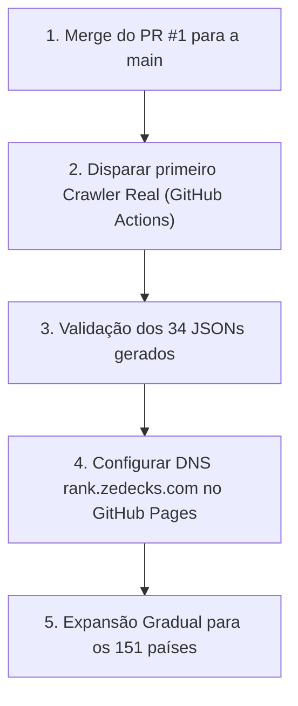

# 📍 Commit Rank v3.0 — Status, Decisões e Próximos Passos

> **Data:** 02 de Novembro de 2026  
> **Versão Oficial:** `v3.0.0` (Tag Git publicada)  
> **Repositório:** [`github.com/iradoweck/commit-rank`](https://github.com/iradoweck/commit-rank)  
> **Domínio de Produção:** [`rank.zedecks.com`](https://rank.zedecks.com)  
> **Ambiente Local:** `http://localhost:2024`  

---

## 1. Onde Estamos (Estado Atual do Projeto)

O projeto concluiu com sucesso a sua transição do modelo legado (arquivos estáticos pré-gerados e pesados) para uma **arquitetura moderna, desacoplada e automatizada (V3)**.

### Componentes Prontos e Validados:
1. **Frontend & Diretório de Países (`index.html`):**
   - **Modelo dos 7 Continentes:** Navegação por abas/filtros por continente (África, Europa, Ásia, América do Norte, América do Sul, Oceânia).
   - **Hero Card Global:** Cartão de destaque dedicado para o ranking **Worldwide** (`GL`) com o ícone circular da ONU/Globo.
   - **Países & Territórios Especiais:** Seção isolada para entidades autonômas ou com status particular (Hong Kong, Macau, Taiwan, Kosovo e Curdistão).
   - **Roster de Lançamento (34 Países):** Curadoria equilibrada e representativa de lançamento.
   - **Bandeiras Circulares SVG:** Integração com o pack `circle-flags` (via CDN) exibindo a bandeira antes do nome de cada país nos cards e no cabeçalho do ranking.
   - **Badges Dinâmicos e Integração:** Geração de snippets Shields.io para perfis individuais e repositórios de organizações.
   - **Apoio ao Projeto:** Modal de doação / metas do Ko-fi (`edmilsonmuacigarro`) e GitHub Sponsors.
   - **Contador Real do GitHub:** Badges dinâmicos no header de PRs abertos e Issues reais (com exclusão calculada de PRs da contagem de issues).

2. **Motor Go CLI (`main.go`, `output/`, `presets.go`):**
   - Adicionada flag nativa `--output json` que cospe um payload estruturado (`data/countries/{country}.json`).
   - Normalização inteligente no Go: mapeia tanto chaves com hífen (`south-africa`) quanto com espaço (`south africa`).
   - 151 presets de extração já existentes e testados.

3. **Pipeline de Automação CI/CD (`.github/workflows/`):**
   - **Crawler Diário (`update-rankings.yml`):** Agendado para rodar diariamente às **01:00 AM (Horário de Moçambique / CAT / 23:00 UTC)**, utilizando o segredo `GH_TOKEN`.
   - **Validação de Código (`go.yml`):** Testes de integridade e compilação do Go.
   - **Resolução do Conflito CodeQL:** Removido o workflow duplicado manual, mantendo a análise de segurança nativa do GitHub ativa e 100% verde.

---

## 2. Decisões Arquiteturais Tomadas

| Decisão | O que foi decidido | Motivo / Justificativa |
| :--- | :--- | :--- |
| **Renomeação de Marca** | Repositório renomeado de `commit-radar` para **`commit-rank`** | Alinhamento direto com o domínio oficial **`rank.zedecks.com`** e propósito de rankings da comunidade. |
| **Domínio Oficial** | Manutenção de **`rank.zedecks.com`** | Mais direto, autoexplicativo para quem visita e perfeito para URLs de badges nos READMEs do GitHub. |
| **Estratégia de Lançamento** | Lançar com **34 entidades** em vez dos 151 presets | Evitar estouro da quota de 5.000 requisições/hora da API GraphQL do GitHub; experiência de lançamento mais rápida e refinada. |
| **Ícones de Bandeiras** | Uso do pack open-source **`circle-flags`** (via jsDelivr / GitHub Pages CDN) | Ícones vetoriais circulares de 32px padronizados, compatíveis com modo claro/escuro e sem peso extra no repositório. |
| **Worldwide Symbol** | Identificador `un.svg` (Nações Unidas / Globo) | O arquivo `earth.svg` estava fora da CDN pública raiz do pacote original; `un.svg` entrega visual perfeito e retorno HTTP 200 garantido. |
| **Subtração de PRs nas Issues** | Subtrair `open_prs` de `open_issues_count` na API REST | A API do GitHub soma PRs no contador geral de issues; a lógica agora garante número exato de issues puras. |
| **Eliminação de Duplicidade CI** | Exclusão do `.github/workflows/codeql.yml` | O GitHub rejeita uploads manuais quando o "Default Setup" do CodeQL já está habilitado nas configurações do repositório. |

---

## 3. Próximos Passos (Roadmap Imediato)

### Passo 1: Merge do Pull Request #1
- O [PR #1](https://github.com/iradoweck/commit-rank/pull/1) (`beta` $\rightarrow$ `main`) já está com o título atualizado, checks verdes e histórico limpo.
- Fazer o merge integrará a V3 diretamente no branch principal.

### Passo 2: Executar o Primeiro Crawler Completo
- No GitHub Actions, disparar manualmente o workflow **Update Country Rankings (JSON)**.
- O bot irá iterar pelos 34 países e salvar os arquivos em `data/countries/*.json`, fazendo o commit automatizado.

### Passo 3: Ativar o Domínio Personalizado no GitHub Pages
- Nas configurações do repositório (`Settings -> Pages`):
  - Selecionar a branch `main` (pasta raiz `/`).
  - Confirmar o Custom Domain: **`rank.zedecks.com`**.
  - Ativar o certificado HTTPS (Enforce HTTPS).

### Passo 4: Expansão Futura de Países (Backlog)
- Adicionar os outros 117 países suportados no backend ao longo do tempo.
- Criar presets para os países lusófonos faltantes no backend (Cabo Verde, São Tomé e Príncipe, Guiné-Bissau).
