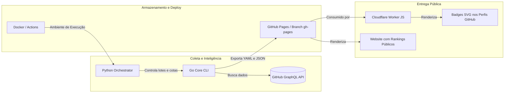

# Panorama Completo de Stacks do Repositório `commit-count`

Este documento apresenta o mapeamento detalhado de **todas as tecnologias, linguagens e ferramentas** que compõem o ecossistema deste projeto, detalhando a responsabilidade exata de cada uma na arquitetura.

---

## 1. Quadro Geral das Tecnologias

| Tecnologia / Stack | Categoria | Arquivos no Repositório | Responsabilidade Principal |
| :--- | :--- | :--- | :--- |
| **Go (Golang 1.17+)** | Backend / Core CLI | `main.go`, `presets.go`, `github/`, `top/`, `output/`, `net/`, `go.mod` | **Motor de extração e classificação.** Faz consultas GraphQL ao GitHub, contorna limites de busca, processa arrays em memória e gera saídas tabulares (Plain, CSV, YAML). |
| **Python 3** | Scripting & Orquestração ETL | `.github/workflows/daily_update.yml` (script inline) | **Orquestrador de execução por lotes.** Lê os presets via CLI, checa frescura de dados (`STALE_DAYS`), calcula lotes de requisições (`MAX_IN_RUN = 3`) e coordena commits no Git. |
| **JavaScript (Node / V8 / Service Worker)** | Edge Serverless API | `badges/cloudflare_worker.js` | **Microsserviço de Badges.** Roda no Cloudflare Workers para ler os dados do ranking e responder requisições de imagens SVG para perfis do GitHub. |
| **Shell Script (Bash)** | Automação DevOps | `badges/deploy` | **Script de publicação.** Empacota e faz o deploy do Worker na Cloudflare usando a API REST da Cloudflare via `curl`. |
| **YAML** | CI/CD & Automação | `.github/workflows/*.yml`, `.github/dependabot.yml`, `.pre-commit-config.yaml` | **Esteiras de automação.** Agendamento cron horário, compilação de binários e atualização automatizada de dependências. |
| **Docker** | Containerização | `Dockerfile` | **Ambiente isolado de build.** Permite compilar e rodar o crawler dentro de containers Linux para consistência entre servidores. |
| **GraphQL (GitHub v4)** | Protocolo de API de Dados | Utilizado internamente em `github/github.go` | **Fonte de dados primária.** Linguagem de consulta para buscar nós de usuários, calendários de contribuições e membros de organizações. |

---

## 2. O que Cada Componente Faz em Detalhes

### 🔷 1. Go (Golang) — O Coração da Aplicação
Decisão acertada de manter o Go: ele é compilado, ultrarrápido, consome pouca memória e produz um binário único e portátil.

- [`main.go`](file:///d:/ZEDECKLAB/WaysPessoais/feramentas/commit-count/main.go): 
  - Lê argumentos de linha de comando (`--token`, `--preset`, `--amount`, `--output`, `--list-presets`).
  - Carrega variáveis de ambiente (`GITHUB_TOKEN`).
  - Direciona a saída para o terminal (`stdout`) ou para arquivos em disco (`--file`).
- [`presets.go`](file:///d:/ZEDECKLAB/WaysPessoais/feramentas/commit-count/presets.go): 
  - Banco de dados em memória contendo dicionários de países, cidades e províncias com palavras-chave de inclusão e exclusão.
  - Possui gerador de **Checksum SHA-256** para validar se as regras de um país foram modificadas.
- [`github/github.go`](file:///d:/ZEDECKLAB/WaysPessoais/feramentas/commit-count/github/github.go): 
  - Cliente de comunicação com a API do GitHub.
  - Constrói a query GraphQL que contorna o bloqueio de ordenação do GitHub.
  - Implementa lógica de repetição com backoff exponencial (`retrying...`) contra quedas e instabilidades de rede.
- [`top/top.go`](file:///d:/ZEDECKLAB/WaysPessoais/feramentas/commit-count/top/top.go): 
  - Camada de serviço intermediária que monta as regras de busca e chama o cliente do GitHub.
- [`output/output.go`](file:///d:/ZEDECKLAB/WaysPessoais/feramentas/commit-count/output/output.go): 
  - Implementa a interface `sort.Interface` do Go para ordenar desenvolvedores por commits, contribuições públicas e totais.
  - Extrai empresas e computa o ranking de organizações mais ativas.
  - Serializa os dados em **Plain Text**, **CSV** ou **YAML**.
- [`net/net.go`](file:///d:/ZEDECKLAB/WaysPessoais/feramentas/commit-count/net/net.go): 
  - Padrão arquitetural de middlewares/wrappers HTTP para injeção automática de tokens (`Authorization: bearer ...`) e Headers de agente.

---

### 🐍 2. Python — O Maestro da Automação (ETL)
Localizado dentro de [`.github/workflows/daily_update.yml`](file:///d:/ZEDECKLAB/WaysPessoais/feramentas/commit-count/.github/workflows/daily_update.yml).
- **Por que existe?** O binário Go processa um país por vez. O script Python atua como o "cérebro da esteira":
  1. Chama o CLI em Go com a flag `--list-presets`.
  2. Compara os arquivos salvos no repositório com os checksums atuais.
  3. Detecta quais países estão desatualizados há mais de 5 dias (`STALE_DAYS = 5`).
  4. Executa no máximo 3 países por rodada (`MAX_IN_RUN = 3`) para nunca ser bloqueado pelo rate limit do GitHub (5.000 pontos/hora).
  5. Atualiza as páginas de saída e dispara os commits no Git.

---

### ⚡ 3. JavaScript (Cloudflare Workers) — A Camada de Apresentação no Edge
Localizado em [`badges/cloudflare_worker.js`](file:///d:/ZEDECKLAB/WaysPessoais/feramentas/commit-count/badges/cloudflare_worker.js).
- **Por que existe?** Para desenvolvedores colocarem no seu perfil do GitHub um badge como:  
  `https://badges.commits.top/mozambique/zedeck.svg`
- O Worker roda nos data centers globais da Cloudflare, faz uma leitura ultrarrápida do JSON pré-processado e responde com o vetor SVG indicando a posição do desenvolvedor no ranking do país.

---

### 🐚 4. Shell Script & CI/CD (Bash + GitHub Actions)
- [`badges/deploy`](file:///d:/ZEDECKLAB/WaysPessoais/feramentas/commit-count/badges/deploy): Script Bash que utiliza comandos `curl` para enviar o código do worker diretamente para a API de computação Edge da Cloudflare.
- [`.github/workflows/go.yml`](file:///d:/ZEDECKLAB/WaysPessoais/feramentas/commit-count/.github/workflows/go.yml): Compila e testa o código Go a cada pull request ou push na branch `master`.
- [`.github/workflows/deploy_badges.yml`](file:///d:/ZEDECKLAB/WaysPessoais/feramentas/commit-count/.github/workflows/deploy_badges.yml): Dispara o deploy do Cloudflare Worker sempre que houver modificações na pasta `badges/`.
- [`.github/dependabot.yml`](file:///d:/ZEDECKLAB/WaysPessoais/feramentas/commit-count/.github/dependabot.yml): Robô do GitHub para checagem diária e atualização de versões de actions do repositório.

---

### 🐳 5. Docker — Portabilidade
- [`Dockerfile`](file:///d:/ZEDECKLAB/WaysPessoais/feramentas/commit-count/Dockerfile): Imagem multi-stage baseada em Alpine Linux que compila o binário Go e gera uma imagem de poucos megabytes, pronta para rodar em qualquer servidor ou kubernetes sem precisar de Go instalado na máquina host.

---

## 3. Resumo da Sinergia da Arquitetura

Manter o **Go** para o motor de coleta e cálculo de ranking é a decisão técnica ideal: ele garante alta performance e confiabilidade com consumo irrisório de CPU e memória.
